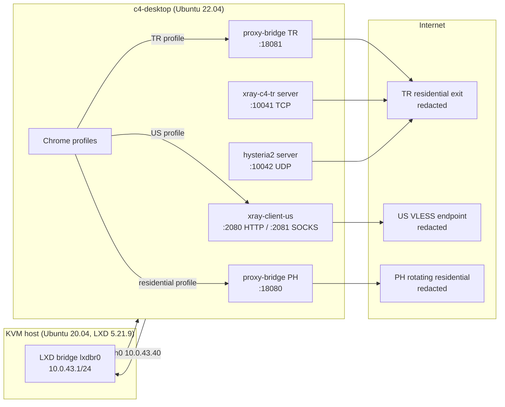

# Linux Fingerprint Browser — Environment Research

[](docs/README.md)
[](docs/en/09-roadmap.md)
[](LICENSE)

A read-only, evidence-first inventory of a containerised Linux browser desktop, used as
the baseline for building a **fingerprint-isolated Chromium browser** on Linux.

This is not a browser yet. It is the measurement layer: what the machine actually is,
what Chrome actually exposes, where the proxy paths go, and which gaps must be closed
before a profile can look like a coherent real user instead of a container.

> Snapshot date: **2026-11-12** · Target: LXD container `c4-desktop` on a KVM host in Tokyo
> · Browser: **Google Chrome 156.0.8078.79** · Desktop: **XFCE 4.16 + XRDP**

---

## Why this repository exists

Most anti-detect products start by randomising JavaScript values. That is the easy part.
The hard part is **coherence**: a profile must agree with itself across the browser,
the OS, the network exit, the clock, the language, the fonts, the GPU, and the automation
surface. This repository records the real starting point so that later patches can be
tested against facts rather than assumptions.

The eventual product scope is broader (Chromium fork, proxy management, DNS leak
prevention, profile isolation, automation, AI/MCP, CI/CD). The current phase is strictly
**information collection**. No VPS service, proxy, desktop, or Chrome configuration is
changed by the collection scripts.

---

## Measured environment at a glance

| Layer | Observed |
|---|---|
| Host | Ubuntu 20.04.6 LTS, kernel 5.4.0-216, KVM, 2 vCPU AMD EPYC-Rome, 3.8 GiB RAM, 22 GB disk (91% used), LXD 5.21.9 |
| Container | Ubuntu 22.04.5 LTS (LXC), 2 vCPU, 4 GiB memory limit, 3.8 GiB visible, same 22 GB ext4 filesystem, **no `/dev/dri`** |
| Desktop | XFCE 4.16, Xorg 1.21.1.4, xorgxrdp 0.2.17, XRDP 0.9.17, display `:10` |
| Display | 1280×720, 96 DPI, 24-bit, RDP session; usable desktop 1280×693 (27 px panel) |
| Browser | Google Chrome 156.0.8078.79, 5 user-data directories, headful + headless probes |
| Runtime | `hardwareConcurrency=2`, `deviceMemory=4`, `devicePixelRatio=1`, timezone `UTC`, locale `en-US` |
| GPU | Host has `/dev/dri/card0`; container has none. Headful WebGL is **disabled**; headless falls back to SwiftShader |
| Fonts | 166 font files, 46 families (DejaVu, Liberation, Noto CJK, URW base35) |
| Network | LXD bridge `10.0.43.0/24`; 3 local proxy bridges; 2 residential TR nodes (VLESS + Hysteria2) |
| Toolchain | gcc/g++/make/python3/git/docker present; **no clang, cmake, ninja, node, rust, go, java** |
| Disk headroom | ~2.1 GiB free — **cannot build Chromium locally** |

Full evidence: [`inventory/`](inventory/) · Analysis: [`docs/en/`](docs/en/)

---

## Ten findings that shape the product

1. **Headful WebGL is broken on this box.** Chrome reports `webgl: disabled_off`,
   `webglRenderer: null`, and logs `WebGL1/2 blocklisted`. Headless Chrome does render
   with SwiftShader. Adding `--enable-unsafe-swiftshader --ignore-gpu-blocklist` restores
   WebGL as `ANGLE (Mesa, llvmpipe ...)`. A fingerprint browser cannot ship a profile where
   `getContext('webgl')` returns `null`.
2. **Geo, clock, and language disagree.** The residential exit is in Turkey, the container
   clock is `UTC`, and Chrome runs `--lang=en-US` with `en-US,en`. A real Turkish desktop
   would normally be `Europe/Istanbul` and `tr-TR`. This is a high-signal mismatch.
3. **`variations_country` retains the country of a previous exit.** The five Chrome
   profiles store `jp`, `ph`, `tr`, and `cn` in `Local State`. It is not exposed to
   JavaScript, but it changes feature rollout and is a strong consistency artefact when
   profiles are cloned or moved between proxies.
4. **All profiles share one desktop and one OS identity.** Every Chrome window runs on
   `:10` as `root`, with the same fonts, CPU count, memory, timezone, and X11 clipboard.
   Per-profile network isolation exists; per-profile **environment** isolation does not.
5. **The screen is unusual and fixed.** 1280×720 with a 27 px panel, `availHeight=693`,
   `outerHeight=719`, `innerHeight=572`. Real 720p desktops exist, but the exact geometry
   is a stable identifier across profiles.
6. **Chrome runs as root with `--no-sandbox`.** `chrome-sandbox` is setuid, but every
   launcher disables the sandbox. This is a security problem first and a stealth problem
   second (crash behaviour, GPU process, `sandboxed: false` in `SystemInfo`).
7. **Leak controls are partially implemented.** QUIC is disabled, WebRTC is restricted to
   proxied UDP, and DoH is disabled — good. But system DNS still goes through
   `systemd-resolved → 10.0.43.1`, IPv6 has a default route, and there is no per-profile
   kill switch or fail-closed policy.
8. **There is no automation surface.** No remote-debugging port, no `chromedriver`, no
   Playwright/Puppeteer, no CDP policy. Any automation layer must be added deliberately.
9. **The build toolchain is absent.** Chromium needs clang, cmake, ninja, Node, ~100 GB
   disk, and 16 GB+ RAM. This container has none of that. Builds must run on GitHub
   Actions, a dedicated builder, or a newer WSL2 host.
10. **Disk is the operational ceiling.** 91% used, 2.1 GiB free on both host and container.
    Profile growth, Chrome updates, and Docker images are already competing for space.

Details and evidence for each finding: [`docs/en/06-fingerprint-surface.md`](docs/en/06-fingerprint-surface.md)

---

## Proxy and network topology



The two public residential nodes (`10041/TCP` VLESS Reality + Vision, `10042/UDP`
Hysteria2 with Salamander obfuscation) both egress through the **same** 24-hour sticky
TR session. `10042/TCP` is unused after the old direct node was removed. Public ports,
credentials, UUIDs, and keys are redacted in this repository.

---

## Repository map

```text
.
├── README.md                     ← you are here (English, primary)
├── docs/
│   ├── README.md                 language index
│   ├── en/                       English analysis (primary)
│   │   ├── 00-overview.md
│   │   ├── 01-host-and-container.md
│   │   ├── 02-desktop-stack.md
│   │   ├── 03-browser-installation.md
│   │   ├── 04-chrome-profiles.md
│   │   ├── 05-proxy-and-network.md
│   │   ├── 06-fingerprint-surface.md
│   │   ├── 07-build-toolchain.md
│   │   ├── 08-architecture.md
│   │   ├── 09-roadmap.md
│   │   └── 10-collection-method.md
│   └── zh-CN/                    Chinese translations (mirror)
├── inventory/
│   ├── container/                sanitised container evidence
│   └── host/                     sanitised host evidence
├── configs/
│   ├── chrome/                   launcher + policy templates
│   ├── proxy/                    Xray/Hysteria2/Mihomo examples
│   └── lxd/                      port-mapping reference
├── scripts/
│   ├── collect-container.sh      read-only collector
│   ├── collect-host.sh           read-only collector
│   └── check-redaction.sh        CI guard against leaked secrets
└── .github/workflows/            redaction check
```

---

## How to read this

| If you want to… | Start here |
|---|---|
| Understand the whole picture in 5 minutes | [`docs/en/00-overview.md`](docs/en/00-overview.md) |
| Reproduce the inventory on another VPS | [`docs/en/10-collection-method.md`](docs/en/10-collection-method.md) |
| See the fingerprint gaps | [`docs/en/06-fingerprint-surface.md`](docs/en/06-fingerprint-surface.md) |
| Design the browser architecture | [`docs/en/08-architecture.md`](docs/en/08-architecture.md) |
| Plan the build | [`docs/en/07-build-toolchain.md`](docs/en/07-build-toolchain.md) |
| See the phased plan | [`docs/en/09-roadmap.md`](docs/en/09-roadmap.md) |
| Read in Chinese | [`docs/zh-CN/`](docs/zh-CN/) |

---

## Redaction policy

This repository is public. The following are **never** published:

- proxy usernames, passwords, session IDs, and provider API signatures;
- VLESS UUIDs, REALITY private/public keys, short IDs, Hysteria2 passwords and obfs keys;
- SSH passwords, private keys, tokens, cookies, and machine-id/boot-id hashes;
- real public IP addresses (replaced with `203.0.113.10`, `198.51.100.x`, `2001:db8::`);
- MAC addresses (masked).

Real values remain only in the private local archive. See [`SECURITY.md`](SECURITY.md).

---

## Status and next step

- **Phase 0 — inventory: complete** (this repository).
- **Phase 1 — reproducible lab + CI:** pin the inventory, add snapshot tests for
  fingerprint coherence, and stand up a Chromium build pipeline outside this VPS.
- **Phase 2 — MVP profile manager:** per-profile proxy, DNS, timezone/locale bundle,
  leak self-test, and ephemeral user-data directories — first without a Chromium fork.

The roadmap deliberately delays the fork until the profile contract and the measurement
harness are stable. Forking Chromium is expensive; fixing coherence in configuration and
network policy is cheap, and it tells us exactly which patches are actually needed.

---

## Responsible use

Fingerprint isolation is dual-use. This project is intended for privacy, multi-account
operations where the platform permits them, QA/testing, ad verification, and security
research. It is **not** intended for fraud, evading lawful enforcement, bypassing platform
bans, or violating a provider's terms. See [`docs/en/11-ethics.md`](docs/en/11-ethics.md).

## License

MIT — see [`LICENSE`](LICENSE).
