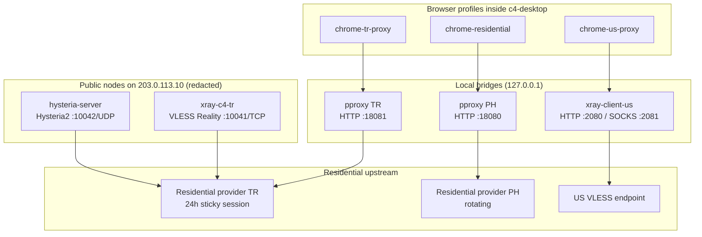

# 05 — Proxy and Network

This is the most operationally sensitive part of the environment. It describes the
proxy chains, the two public residential nodes, DNS, leak controls, latency, and the
gaps that a fingerprint browser must close.

All credentials, UUIDs, keys, session IDs, and public addresses are redacted.

---

## 1. Topology



There are two distinct uses of the residential upstream:

1. **Browser-local bridges** (`18080`, `18081`) — used by Chrome via `--proxy-server`.
2. **Public nodes** (`10041/TCP`, `10042/UDP`) — used by remote clients (v2rayN, Clash,
   Shadowrocket) and by the VLESS/Hysteria2 test matrix.

Both paths currently share the same TR sticky session. That is convenient for consistency
but means all TR traffic competes for the same residential bandwidth and session quota.

---

## 2. Local bridges

### 2.1 US VLESS — `xray-client-us`

| Property | Value |
|---|---|
| Service | `xray-client-us.service` |
| Listen | `127.0.0.1:2080` HTTP, `127.0.0.1:2081` SOCKS5 |
| Protocol | VLESS + REALITY + `xtls-rprx-vision` |
| Transport | TCP |
| TLS fingerprint | `chrome` |
| UDP | SOCKS inbound has `udp: true`; outbound is TCP-only |
| Endpoint | Redacted (`198.51.100.20:24447` in public copies) |
| Used by | `chrome-us-proxy`, Claude/Codex terminal work |

The HTTP inbound has a 300 s timeout. The SOCKS inbound supports UDP locally, but the
VLESS outbound is TCP, so UDP is effectively limited.

### 2.2 PH rotating — `proxy-bridge`

| Property | Value |
|---|---|
| Service | transient `proxy-bridge.service` (systemd-run) |
| Process | `pproxy 2.7.9` (Python) |
| Listen | `127.0.0.1:18080` HTTP |
| Upstream | Residential provider PH rotating residential |
| Used by | `chrome-residential` |

This is a **transient** unit, not a file in `/etc/systemd/system`. It will not survive a
reboot unless something recreates it. That is a reliability risk.

### 2.3 TR sticky — `proxy-bridge-tr`

| Property | Value |
|---|---|
| Service | `proxy-bridge-tr.service` (permanent) |
| Process | `pproxy 2.7.9` |
| Listen | `127.0.0.1:18081` HTTP |
| Upstream | Residential provider TR 24h sticky session |
| Exit | Turkish residential (redacted) |
| Used by | `chrome-tr-proxy` |

The unit embeds the upstream URL, including the session username and password, in
`ExecStart`. The file is readable by root only in practice, but the credential is visible
in `systemctl cat` and in the process list. A production design should use an
`EnvironmentFile` with `0600` permissions or a local credential broker.

---

## 3. Public residential nodes

### 3.1 VLESS Reality — `10041/TCP`

| Property | Value |
|---|---|
| Service | `xray-c4-tr.service` |
| Binary | `/usr/local/bin/xray-26.6.27` (pinned) |
| Listen | `0.0.0.0:10041` |
| Protocol | VLESS + REALITY + Vision |
| SNI target | `addons.mozilla.org:443` |
| Flow | `xtls-rprx-vision` |
| UDP | Not supported (HTTP upstream is TCP-only) |
| Upstream | Residential provider TR HTTP proxy |
| Routing | `tr-residential-in` → `tr-http-out`; blackhole available |

The Xray version is pinned to `26.6.27` because newer REALITY implementations failed
authentication with Mihomo clients. This is a compatibility constraint, not a preference.
Any upgrade must be tested against the client matrix before rollout.

### 3.2 Hysteria2 — `10042/UDP`

| Property | Value |
|---|---|
| Service | `hysteria-server.service` |
| Binary | `/usr/local/bin/hysteria` 2.13.0 |
| Listen | `:10042` UDP |
| Auth | password (redacted) |
| Obfuscation | Salamander (password redacted) |
| TLS | self-signed, CN `www.bing.com`, 10 years |
| SNI guard | disabled |
| UDP forwarding | `disableUDP: true` |
| Upstream | the same Residential provider TR HTTP proxy |
| Masquerade | reverse proxy to `https://www.bing.com` |

Hysteria2 is QUIC-based, so the client-to-VPS leg is UDP and encrypted. The VPS-to-Residential provider
leg is still an HTTP proxy, which cannot carry UDP. `disableUDP: true` is therefore
correct: the node tunnels TCP inside QUIC, it does not provide end-to-end UDP.

The self-signed certificate requires `insecure=1` / `skip-cert-verify` on clients. That
weakens authentication and should be replaced with a real certificate or a pinned public
key in a production deployment.

### 3.3 Port status

| Port | Protocol | Status |
|---|---|---|
| `10041` | TCP | VLESS Reality + Vision, active |
| `10042` | UDP | Hysteria2, active |
| `10042` | TCP | No listener; old direct node removed |
| `2204` | TCP | SSH to container |
| `3389` | TCP + UDP | XRDP |
| `8088` | TCP | goods24 web (Caddy) |

`10042/TCP` still has an LXD proxy device. It is harmless while unused but should be
removed to reduce surface area.

---

## 4. DNS

Current path:

```text
Chrome
  → systemd-resolved stub 127.0.0.53
  → upstream 10.0.43.1 (LXD dnsmasq)
  → host resolver
  → internet
```

Chrome is launched with `--disable-features=DnsOverHttps`, so it does not use DoH. With an
HTTP proxy, Chrome sends the destination hostname to the proxy for HTTP and for HTTPS
CONNECT; the proxy resolves it. That is good for the proxied path. But:

- system services, Chrome background services, and any non-proxied request still use the
  local resolver;
- there is no per-profile DNS resolver;
- there is no DNS leak test in the launcher;
- the resolver can see every non-proxied hostname.

A fingerprint browser should route DNS through the same egress as the profile, or run a
per-profile resolver that is bound to the proxy path. "Disable DoH" is not a DNS leak
policy; it is the absence of one.

---

## 5. IPv6 — a real leak

The container has:

```text
eth0: 10.0.43.40/24
      fd42:43::216:3eff:fe41:db37/64
default via fe80::216:3eff:fed8:d793 dev eth0
```

Despite having only a ULA address, IPv6 egress works:

```text
$ curl -6 https://api64.ipify.org
2001:db8::10
```

That is the **host's global IPv6 address in Tokyo**, not the Turkish residential exit.
Any IPv6-capable direct connection bypasses the IPv4 residential proxy. Chrome's
`--proxy-server` covers HTTP(S) URLs, and WebRTC is restricted, so the common paths are
protected. But the leak is latent:

- a proxy bypass rule that matches an IPv6 destination;
- a Chrome background request that does not use the proxy;
- an extension or automation script using raw sockets;
- future features that enable direct UDP or IPv6.

Recommendation for the product: disable IPv6 in the profile network namespace, or
firewall it fail-closed, and add an IPv6 leak check to the preflight test.

---

## 6. Leak-control matrix

| Vector | Current control | Status |
|---|---|---|
| HTTP(S) destination | `--proxy-server` per profile | Covered |
| QUIC / HTTP3 | `--disable-quic` | Covered |
| WebRTC UDP | policy + flag, `disable_non_proxied_udp` | Covered |
| WebRTC local IP | `--enforce-webrtc-ip-permission-check` | Covered |
| DoH | `--disable-features=DnsOverHttps` | Disabled, but not replaced |
| System DNS | none | **Leak** |
| IPv6 | none | **Leak** (verified direct egress) |
| Non-HTTP protocols | none | **Leak** for raw sockets |
| Proxy failure | Chrome shows an error, no kill switch | **Fail-open** at OS level |
| Timezone | none | **Mismatch**, not a network leak |
| Language | none | **Mismatch**, not a network leak |

A production launcher needs a **fail-closed** network policy: if the proxy is down, the
profile must have no direct egress. Today, killing `proxy-bridge-tr` leaves the container
with direct internet access; Chrome will show a proxy error, but other processes can still
reach the internet.

---

## 7. Latency

The residential path is measured in **wall-clock HTTP request time**, not ICMP. Three
layers are often confused:

1. **TCP RTT to the VPS** — what `tcping 203.0.113.10 10041` measures. Changing the
   residential exit does not change this.
2. **VPS → residential gateway RTT** — the HTTP proxy connect time, ~170–190 ms in the
   benchmark.
3. **End-to-end page/request time** — includes the residential last mile and the target
   site; ~1.3 s for `generate_204` from the container with a sticky session.

Benchmark of ten 24-hour sticky sessions from inside the container:

| Session rank | `time_total` (3 runs) | Exit |
|---|---|---|
| 1 (selected) | 1.27–1.40 s | TR |
| 2 | 1.38–1.42 s | TR |
| 3 | 1.46–1.50 s | TR |
| 4 | 1.58–1.65 s | TR |
| 5 | 1.58–1.72 s | TR |
| 6 | 1.73–2.01 s | TR |
| 7 | 1.75–2.13 s | TR |
| 8 | 2.05–2.42 s | TR |
| 9 | 3.21–4.21 s | TR |
| 10 | timeout | unreachable |

The selected session was the fastest and most stable. End-to-end tests from a client
machine:

| Node | HTTP total (3 runs) |
|---|---|
| VLESS `10041/TCP` | 1.89 / 1.89 / 1.91 s |
| Hysteria2 `10042/UDP` | 1.62 / 1.64 / 1.89 s |

Hysteria2 is slightly faster because the client-to-VPS leg is QUIC over UDP and avoids
TCP head-of-line blocking. Both exits are the same Turkish residential IP.

### Interpreting "700 ms"

A 700 ms figure is usually a TCP handshake to the VPS, not a page load. It will not
improve by changing the residential session. If the complaint is about page latency,
measure the three layers separately and compare like with like. If it is about the
residential last mile, choose a faster session (as done here) or a different provider.

---

## 8. Session lifecycle

The TR session has a 24-hour TTL. When it expires, the upstream username must be replaced
in three places:

1. `/etc/xray-c4-tr/config.json` — `tr-http-out` user;
2. `/etc/hysteria/config.yaml` — `outbounds[0].http.url`;
3. `/etc/systemd/system/proxy-bridge-tr.service` — `-r` argument.

Then restart:

```bash
systemctl restart xray-c4-tr hysteria-server proxy-bridge-tr
```

A production system should automate this:

- generate N candidate sessions;
- benchmark each from the VPS;
- select the fastest stable one;
- update all three configs atomically;
- restart and verify the exit IP/country;
- roll back on failure;
- never put a metered residential node in a latency-based auto-test group.

The last point matters: a Clash `url-test` group will probe the node continuously and burn
residential bandwidth. The supplied Clash config deliberately has no auto-test group.

---

## 9. Security observations

| Observation | Risk |
|---|---|
| Residential provider upstream is plain HTTP | Credentials and proxied requests on the VPS→gateway leg are not TLS-protected |
| Proxy credentials in `ExecStart` | Visible in process list and unit file |
| Hysteria2 self-signed cert + `insecure=1` | No server authentication for clients |
| Xray pinned to an older version | Known compatibility trade-off; must be tracked for CVEs |
| `10042/TCP` mapping unused | Unnecessary surface |
| No fail-closed policy | Proxy failure falls back to direct egress |
| Residential provider sees traffic | The provider is a trusted third party by definition |

The plaintext HTTP upstream is the most important: the VLESS/Hysteria2 encryption stops at
the VPS. From the VPS to `proxy.example-provider.net:32345`, the HTTP proxy carries credentials and
request metadata without TLS. A future design should use an HTTPS proxy endpoint or a
provider that supports TLS, or tunnel the HTTP proxy through a TLS connection.

---

## 10. Evidence

- [`../../inventory/container/08-proxy-services.txt`](../../inventory/container/08-proxy-services.txt)
- [`../../inventory/container/09-network.txt`](../../inventory/container/09-network.txt)
- [`../../inventory/container/proxy-latency.md`](../../inventory/container/proxy-latency.md)
- [`../../inventory/host/04-ports.txt`](../../inventory/host/04-ports.txt)
- [`../../configs/proxy/`](../../configs/proxy/)
