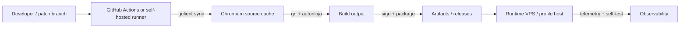

# 07 — Build Toolchain and Chromium Build Options

The current VPS is a runtime, not a build machine. This document records the toolchain
gap and lays out realistic options for producing a Chromium fork.

---

## 1. What is installed

| Tool | Version | Present |
|---|---|---|
| gcc | 11.4.0 (Ubuntu 11.4.0-1ubuntu1~22.04.3) | yes |
| g++ | 11.4.0 | yes |
| make | GNU Make 4.3 | yes |
| Python | 3.10.12 | yes |
| pip | 22.0.2 | yes |
| git | 2.34.1 | yes |
| Docker | 29.9.3 | yes |
| containerd | 2.4.2 | yes |
| pkg-config | — | **no** |
| clang / clang++ | — | **no** |
| cmake | — | **no** |
| ninja | — | **no** |
| node / npm / pnpm / yarn | — | **no** |
| rustc / cargo | — | **no** |
| go | — | **no** |
| java / javac | — | **no** |
| chromedriver | — | **no** |

Installed Python packages are the Ubuntu defaults (Babel, cryptography, dbus-python,
Jinja2, jsonschema, etc.), not a browser-automation stack. There is no Playwright,
Puppeteer, Selenium, or websocket client.

---

## 2. What a Chromium build needs

A modern Chromium checkout and build typically require:

| Resource | Requirement | This box |
|---|---|---|
| Disk | ~100 GB free (source + build + cache) | **2.1 GiB** |
| RAM | 16 GB+ recommended; 8 GB minimum for a narrow build | **3.8 GiB** |
| CPU | 8+ cores recommended; 2 cores will take many hours | **2 vCPU** |
| OS | Linux with a recent glibc; Ubuntu 22.04 is acceptable | Ubuntu 22.04 |
| Toolchain | clang, ninja, Python 3, pkg-config, Node for some tooling | mostly missing |
| `depot_tools` | Required for `gclient`, `gn`, `autoninja` | absent |

The disk is the hard blocker. Even a component build with a reduced target set will not
fit in 2 GiB. Compiling on this VPS is not viable.

---

## 3. Options

### Option A — GitHub Actions hosted runners

**Pros:** no infrastructure to maintain; reproducible; free minutes for public repos.
**Cons:** standard runners have ~14 GB of SSD free, which is not enough for a full
Chromium build. Larger runners (more disk/CPU) are paid. Builds are slow and queue.

Use for:

- documentation checks and redaction checks (already in this repo);
- patch application tests;
- small unit tests against a prebuilt Chromium;
- not for a full browser build unless a larger runner is provisioned.

### Option B — GitHub Actions larger runners / self-hosted runner

**Pros:** ≥100 GB disk, more cores, persistent ccache, full control.
**Cons:** cost, maintenance, security of a runner that builds untrusted patches.

This is the recommended path for the first fork builds. A self-hosted runner can be a
dedicated machine (not this VPS) with 8–16 cores, 32 GB RAM, and 500 GB NVMe.

### Option C — Dedicated build server

A stand-alone Linux box or a cloud VM with:

- 8–16 vCPU;
- 32 GB RAM;
- 500 GB NVMe;
- Ubuntu 22.04/24.04;
- `depot_tools`, clang, ninja, Node, ccache.

Build once, publish artifacts, and keep the VPS as the runtime/control plane. This is the
cleanest separation of concerns.

### Option D — WSL2 on the user's Windows machine

**Pros:** local iteration, no cloud cost, Windows and Linux builds from one machine.
**Cons:** disk/RAM heavy; WSL2 I/O is slower; Windows build still needs a Windows
toolchain and a separate checkout.

Useful for development and for the later Windows target, not as the primary Linux CI.

### Option E — Build on this VPS

Not viable. Do not attempt to install a toolchain and build here; it will fill the disk
and destabilise the live services.

---

## 4. Recommended build architecture



Principles:

1. **Never build on the runtime VPS.** Disk and memory are already tight.
2. **Pin the Chromium revision.** A branch name is not a version. Record the commit hash.
3. **Cache aggressively.** `ccache`/`sccache` and a persistent `depot_tools` checkout cut
   build times substantially.
4. **Build only what you ship.** A full Chrome build is enormous; a custom browser can
   disable unneeded targets, but do not over-optimise before the patch set is stable.
5. **Sign and verify artifacts.** A browser is a high-value binary; unsigned builds are
   not shippable.
6. **Keep a rollback build.** Every release should have the previous known-good artifact.

---

## 5. Fork strategy

### 5.1 Chromium vs Chrome

| Aspect | Chromium | Google Chrome |
|---|---|---|
| License | BSD-style, open source | Proprietary |
| Branding | Chromium | Google |
| Proprietary codecs | Not included by default | Included |
| Widevine | Not included | Included |
| Sync / Google services | Not included | Included |
| Build | You build it | Google builds it |
| Fingerprint baseline | More "generic" | More common |

For a fingerprint browser, Chromium is the practical base. Proprietary codecs and
Widevine can be added later if the product needs video playback (many sites do). The
absence of codecs is itself detectable (`canPlayType`), so decide early.

### 5.2 Patch surface

Keep the patch set small and layered:

| Layer | Examples | Maintenance |
|---|---|---|
| Build configuration | branding, flags, features, codecs | Low |
| Browser policy | defaults, profile handling, proxy | Low |
| Network | DNS, proxy, IPv6, leak guard | Medium |
| Blink | UA, languages, screen, fonts, canvas, WebGL | High |
| GPU | renderer strings, parameter virtualisation | High |
| Automation | CDP policy, headless behaviour | Medium |

Prefer, in order:

1. a command-line flag or feature;
2. a managed policy;
3. a small patch in `chrome/browser/` or `components/`;
4. a Blink/GPU patch.

Every patch must have a test and a rebase note. Chromium ships roughly every four weeks;
a patch that cannot be rebased cheaply will become technical debt.

### 5.3 Candidate patch points

Paths change between milestones; verify at the pinned revision. Typical areas:

| Area | Path (indicative) |
|---|---|
| UA / UA-CH | `components/embedder_support/user_agent_utils.cc` |
| Navigator | `third_party/blink/renderer/core/frame/navigator.cc` |
| Screen | `third_party/blink/renderer/core/frame/screen.cc` |
| WebGL | `third_party/blink/renderer/modules/webgl/` |
| Canvas | `third_party/blink/renderer/modules/canvas/` |
| Audio | `third_party/blink/renderer/modules/webaudio/` |
| Fonts | `third_party/blink/renderer/platform/fonts/` |
| Timezone | `third_party/blink/renderer/core/timezone/` |
| Client hints | `third_party/blink/renderer/core/loader/` and `services/network/` |
| Proxy / DNS | `services/network/`, `net/dns/` |
| Profile / policy | `chrome/browser/profiles/`, `components/policy/` |
| Switches | `content/public/common/content_switches.cc` |

A safer alternative to patching Blink directly is to inject at the **Mojo/network service
boundary** and at the **renderer process launch** layer, where the surface is smaller.
The trade-off is that some values (canvas, fonts) are inherently renderer-side.

### 5.4 Build configuration

- `is_debug = false`, `is_component_build = false` for release.
- `symbol_level = 1` for usable crash stacks without a huge binary.
- `enable_nacl = false`, `enable_widevine = false` initially.
- Branding: set `chrome/browser/resources` and `BRANDING` files; do not ship Google
  trademarks.
- Codecs: `proprietary_codecs = true` + `ffmpeg_branding = "Chrome"` if needed.
- Official build: `is_official_build = true` for optimised release.
- Signing: platform-specific; Linux packages can be `.deb`/`.rpm`/AppImage.

---

## 6. CI design

Minimum pipeline:

```text
lint (docs, redaction)
  → patch apply (git apply --check)
  → configure (gn gen)
  → compile (autoninja, cached)
  → package
  → smoke test (launch, version, fingerprint probe)
  → publish artifact
```

Smoke tests should run the browser headful if possible; headless is not representative
(see `06-fingerprint-surface.md`). A GPU-less CI runner will reproduce the same WebGL
problem as this VPS, so either pass a GPU or test with the SwiftShader flags.

---

## 7. Windows and WSL later

The brief mentions a possible Windows target. Plan for it, but do not block the Linux
product:

- Chromium's Windows build requires Visual Studio, the Windows SDK, and a Windows
  checkout; it cannot be cross-compiled from Linux.
- WSL2 is useful for the Linux side and for developer parity, not for producing the
  Windows binary.
- A Windows runner (self-hosted or GitHub-hosted) is required for the Windows artifact.
- Fingerprint values (fonts, GPU, screen, media devices) are platform-specific; the
  profile schema must be platform-aware from day one.

---

## 8. Cost and time estimate (order of magnitude)

| Item | Estimate |
|---|---|
| First full checkout | 30–60 min on a fast link, ~40 GB |
| First build (16 cores) | 1–3 hours |
| Incremental build | 5–30 min |
| Patch rebase per Chromium milestone | 1–5 days depending on surface |
| CI runner | 16 vCPU / 32 GB / 500 GB, monthly cost varies |
| Storage | 500 GB NVMe minimum |

These are planning numbers, not commitments. Measure on the chosen builder.

---

## 9. Decision

For the next phase:

1. Keep this VPS as the **runtime and measurement** host.
2. Provision a **separate builder** (self-hosted or larger CI runner).
3. Start with **stock Chrome + supervisor** to validate the profile contract.
4. Fork Chromium only after the self-test harness and the coherence manifest are stable.
5. Build Linux x64 first; add Windows x64 when the Linux patch set is maintainable.

---

## 10. Evidence

- [`../../inventory/container/12-toolchain.txt`](../../inventory/container/12-toolchain.txt)
- [`../../inventory/container/11-software.txt`](../../inventory/container/11-software.txt)
- [`../../inventory/host/00-system.txt`](../../inventory/host/00-system.txt)
