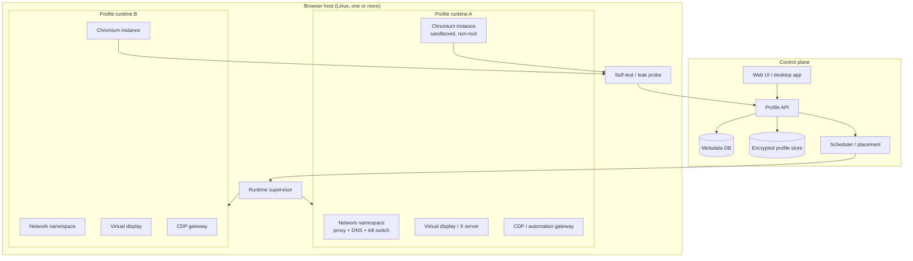

# 08 — Target Architecture

This document turns the inventory into a design for a Linux fingerprint browser. It is a
proposal, not an implementation. The guiding rule is: **coherence first, isolation second,
spoofing third**.

---

## 1. Design principles

1. **A profile is an environment, not a directory.** Cookies are the easy part. Timezone,
   locale, fonts, display, GPU, media devices, and network must belong to the profile too.
2. **Coherence beats randomness.** A random WebGL string that contradicts the OS, GPU,
   and driver is worse than a plain but consistent value.
3. **Deterministic per profile.** The same profile must produce the same fingerprint
   across launches. Randomise once at creation, then persist the seed.
4. **Fail closed.** If the proxy, DNS, or self-test fails, the profile must not fall back
   to direct egress.
5. **Least privilege.** The browser runs as a non-root user, with the sandbox enabled,
   in its own namespace/container.
6. **Measure everything.** Every launch produces a self-test report that can be diffed.
7. **Patch late, patch small.** Use flags, policies, and OS isolation before touching
   Blink. Fork only for what cannot be solved outside the browser.

---

## 2. System overview



### Components

| Component | Responsibility |
|---|---|
| **Control plane** | Profile CRUD, ownership, quotas, scheduling, audit log |
| **Profile store** | Encrypted user-data dirs, manifests, snapshots, artifacts |
| **Fingerprint compiler** | Persona + seed → coherent manifest |
| **Runtime supervisor** | Create namespace/display, start browser, enforce limits, restart on crash |
| **Network plane** | Per-profile proxy, DNS, IPv6 policy, kill switch, leak test |
| **Browser runtime** | Stock Chrome first; Chromium fork later |
| **Automation gateway** | CDP/Playwright/MCP access with authentication |
| **Observability** | Self-test, screenshots, logs, fingerprint diffs, alerts |

---

## 3. Profile model

A profile is a versioned record plus an encrypted data directory.

```yaml
schema_version: 1
id: tr-ist-01
name: "TR Istanbul / Linux desktop"
seed: "<64 hex chars, generated once>"
created_at: "2026-11-12T00:00:00Z"
chrome_version: "156.0.8078.79"
patchset_version: "0.1.0"

persona:
  platform: linux          # linux | windows | macos (target)
  fidelity: native         # native | masked | cross-platform
  timezone: Europe/Istanbul
  locale: tr-TR
  languages: [tr-TR, tr]
  currency: TRY
  screen: {width: 1920, height: 1080, dpr: 1}
  color_scheme: light
  media:
    audio_output: true
    audio_input: false
    video_input: false
  fonts: default-linux-tr
  gpu: {mode: software, vendor: "Google Inc. (Mesa)", renderer: "ANGLE (Mesa, llvmpipe ...)"}

network:
  mode: http_proxy
  endpoint: "http://127.0.0.1:18081"
  expected_exit: {country: TR, timezone: Europe/Istanbul, asn: "<redacted>"}
  dns: remote
  ipv6: disabled
  kill_switch: true

automation:
  cdp: true
  cdp_auth: token
  webdriver: false
  allowed_origins: ["http://127.0.0.1:..."]

lifecycle:
  storage_quota_gb: 5
  snapshot_on_exit: true
  ephemeral: false
```

The **manifest** is the compiled, immutable description of what the browser should
expose. The **seed** is the only random input; everything else is derived deterministically
from it and the persona. This makes profiles reproducible and testable.

### Fidelity tiers

| Tier | Meaning | Feasible now? |
|---|---|---|
| **Native** | Linux persona on Linux; UA, fonts, GPU all consistent | Yes |
| **Masked** | Linux host, but a different locale/timezone/screen/network | Yes |
| **Cross-platform** | Windows/macOS persona on Linux | Not without a fork or a VM |

For the MVP, ship **native Linux personas**. A Windows persona on Linux Chrome is a
contradiction that requires either a heavily patched Chromium or a Windows VM. Do not
promise it before it is testable.

---

## 4. Runtime isolation

### 4.1 Options

| Option | Isolation | Cost | Notes |
|---|---|---|---|
| Separate `--user-data-dir` | Storage only | Low | Current state; not enough |
| Separate Linux user + X display | Medium | Low | Better; still shared kernel/network |
| Container per profile | High | Medium | LXD/Docker; own netns, display, fonts |
| Network namespace per profile | High (network) | Medium | Rootful; nftables, veth, DNS |
| VM per profile | Highest | High | KVM; needed for Windows personas |
| Container per profile group | Medium-high | Medium | Pragmatic: 5–10 profiles per container |

**Recommendation:** start with **one container per profile group**, and a **network
namespace per profile** inside it (or one container per profile if the density is
acceptable). This gives each profile its own display, fonts, timezone, and network without
the cost of a VM per profile.

### 4.2 Display

Options:

- **Xvfb per profile** — lightweight, but no GPU and no window manager; good for headless
  automation, poor for realistic screen/window signals.
- **Xorg + XRDP per profile** — realistic, but heavy; one X server per profile.
- **Xephyr/nested X** — moderate; shares the host X server.
- **Wayland headless compositor** — modern, but Chrome's Ozone/Wayland path changes the
  fingerprint.

For the MVP, Xvfb with a fixed geometry per profile is enough to make `screen` coherent.
For a desktop-like product, Xorg/XRDP per profile is better. The current single `:10` is
the thing to eliminate.

### 4.3 Privileges

- Run Chrome as a dedicated non-root user per profile.
- Keep the sandbox enabled (`chrome-sandbox` setuid or user namespaces).
- Drop capabilities; mount `/tmp` and the profile dir with `nosuid,nodev,noexec` where
  possible.
- Disable shared clipboard between profiles.
- Do not mount the Docker socket or host paths into the browser container.

---

## 5. Network plane

### 5.1 Requirements

- Every profile has exactly one egress path.
- DNS goes through the same path (remote DNS for HTTP/SOCKS5h).
- IPv6 is disabled or routed through the proxy.
- No direct egress if the proxy is down.
- No UDP except what the proxy explicitly supports.
- Per-profile traffic accounting.
- Health checks that do not burn metered residential bandwidth.

### 5.2 Implementation sketch

```text
profile netns
  ├─ veth pair → bridge → nftables
  ├─ default route → proxy bridge (local)
  ├─ reject all direct output except to the proxy bridge
  ├─ redirect/deny UDP 53 to non-proxy resolvers
  ├─ disable IPv6 (sysctl net.ipv6.conf.all.disable_ipv6=1)
  └─ kill switch: if proxy health check fails, drop all output
```

For an HTTP proxy, Chrome resolves hostnames at the proxy for HTTP and CONNECT. For
SOCKS5h, use remote DNS. For any direct DNS, run a resolver bound to the profile and
forward it through the proxy (DoH over the proxy) rather than the host resolver.

### 5.3 Leak tests

Run before every launch and on a schedule:

| Test | Expected |
|---|---|
| IPv4 exit | Matches the profile's country/ASN |
| IPv6 exit | None, or matches the profile |
| DNS resolver | The profile's resolver, not the host's |
| WebRTC candidates | Proxied or empty |
| QUIC | Disabled |
| Direct TCP to a canary | Blocked |
| Proxy down | All egress blocked, clear error |

The current environment fails the IPv6 and DNS tests (see `05-proxy-and-network.md`).

---

## 6. Fingerprint plane

### 6.1 What the compiler produces

| Domain | Values |
|---|---|
| UA / UA-CH | Browser version, platform, architecture, bitness, model, platform version |
| Navigator | `platform`, `vendor`, `languages`, `hardwareConcurrency`, `deviceMemory`, `maxTouchPoints` |
| Screen | width, height, avail, DPR, color depth, orientation |
| Timezone / locale | `Intl` timezone, locale, calendar, numbering system, currency |
| WebGL / WebGPU | vendor, renderer, parameters, extensions |
| Canvas / audio | deterministic per-profile noise, consistent across APIs |
| Fonts | family list and metrics |
| Media | device kinds, labels, capabilities |
| Speech | voices and languages |
| Network | effective type, downlink, RTT (or omit) |
| Storage | quota (avoid container artefacts) |

### 6.2 Determinism

- Derive values from `HMAC(seed, domain)` so each domain is stable and independent.
- Persist the compiled manifest; do not re-roll on every launch.
- Version the compiler; a compiler upgrade creates a new manifest version and a diff.
- Log every manifest change with the reason.

### 6.3 What to spoof vs what to virtualise

| Approach | Pros | Cons |
|---|---|---|
| **Virtualise** (real GPU, real fonts, real devices) | Most coherent; fewer patches | Expensive; hard to vary per profile |
| **Spoof in Blink** | Flexible; per-profile | High maintenance; cross-checks can detect |
| **Spoof at the boundary** (Mojo, CDP, proxy) | Smaller patch surface | Not enough for canvas/fonts |

The practical mix:

- virtualise the network, display, timezone, locale, and fonts where possible;
- spoof UA-CH, WebGL strings, canvas/audio noise, and media device labels in the browser;
- keep a single source of truth (the manifest) for all of them.

### 6.4 Cross-checks to survive

A serious anti-detect target will cross-check:

- UA vs UA-CH vs `navigator.platform` vs `userAgentData`;
- timezone vs `Intl` vs `Date` vs IP geolocation;
- WebGL vendor/renderer vs GPU info vs canvas performance;
- fonts vs canvas metrics vs `document.fonts.check`;
- screen vs window vs `devicePixelRatio` vs screenshot;
- media devices vs `enumerateDevices` vs actual permission prompts;
- TCP/TLS/HTTP2 fingerprint vs claimed browser;
- behaviour vs automation flags.

The manifest must be internally consistent for all of these, not just the easy ones.

---

## 7. Browser layer

### 7.1 Stock Chrome + supervisor (MVP)

Use Chrome's flags, policies, and OS isolation:

- `--proxy-server`, `--disable-quic`, WebRTC policy;
- per-profile `--user-data-dir`;
- per-profile container/namespace with `TZ`, `LANG`, fonts, display;
- `--enable-unsafe-swiftshader --ignore-gpu-blocklist` to restore WebGL;
- `--accept-lang` and `--lang`;
- no `--enable-automation`; controlled CDP port with auth.

This covers network, profile, timezone, locale, and WebGL availability. It does **not**
cover GPU strings, canvas/font metrics, or UA-CH on a non-native platform.

### 7.2 Chromium fork (later)

Add, in order:

1. UA-CH and platform coherence;
2. timezone/locale per renderer (or per profile process);
3. WebGL/WebGPU vendor/renderer and parameter virtualisation;
4. canvas/audio deterministic noise;
5. font metric virtualisation;
6. media device virtualisation;
7. automation/CDP policy;
8. branding and packaging.

Each patch needs a test in the self-test harness and a rebase note. Keep the patch stack
in a separate repository or a `patches/` directory with a manifest.

### 7.3 Build vs buy

| Approach | Time to MVP | Control | Maintenance |
|---|---|---|---|
| Stock Chrome + supervisor | Weeks | Medium | Low |
| Chromium fork + patches | Months | High | High |
| Electron/CEF wrapper | Weeks | Low-medium | Medium (but not a real browser) |
| VM per profile + stock Chrome | Weeks | Medium | Medium-high |
| Buy an existing anti-detect product | Days | Low | Vendor-dependent |

The brief references BitBrowser and Ziniao. They validate the market, but they are
closed systems. A credible open product needs its own profile contract and measurement
harness, even if the first runtime is stock Chrome.

---

## 8. Automation and AI/MCP

### 8.1 CDP gateway

- Bind CDP to `127.0.0.1` on an ephemeral port.
- Put a local authenticated gateway in front; never expose CDP to the network.
- Use `--remote-debugging-pipe` where possible, or a token-protected WebSocket.
- Avoid `--enable-automation` unless the profile is explicitly an automation profile.
- Document that `navigator.webdriver` and other automation artefacts must match the
  profile's policy.

### 8.2 Playwright / Puppeteer

- Launch with `connectOverCDP` to the gateway, not by letting Playwright spawn Chrome
  with its own flags.
- Keep the browser launch flags under the supervisor's control; automation must not
  override proxy, WebGL, or language flags.
- Capture a self-test report at the start of every automated session.

### 8.3 MCP / LLM

An MCP server can expose tools such as:

- `profile.create`, `profile.start`, `profile.stop`, `profile.status`;
- `browser.navigate`, `browser.screenshot`, `browser.evaluate`;
- `fingerprint.self_test`, `network.leak_test`;
- `profile.export`, `profile.import`.

Guardrails: per-profile authorization, rate limits, audit logs, no secret exfiltration,
and a clear human-in-the-loop policy for destructive actions.

---

## 9. Storage and secrets

| Data | Store | Protection |
|---|---|---|
| Profile metadata | PostgreSQL/SQLite | Access control, backups |
| User-data dirs | Encrypted volume or per-profile encryption | Key in OS keyring/HSM |
| Proxy credentials | Secret manager, injected at launch | Never in Git or logs |
| Manifests | Metadata DB + object store | Versioned, signed |
| Self-test reports | Object store | Retention policy |
| Screenshots | Object store | PII review |

The current VPS keeps credentials in unit files and config files. The product should
never do that. Use an `EnvironmentFile` with `0600` at minimum, and a secret manager at
scale.

---

## 10. Observability

Every profile launch should emit:

- a structured log (profile id, Chrome version, patchset, proxy, exit IP/country);
- a self-test JSON (the contract in `06-fingerprint-surface.md`);
- a screenshot of a known test page;
- a diff against the previous run;
- a leak-test result;
- a crash report id (if any).

Dashboards:

- launch success rate;
- self-test pass rate by check;
- leak incidents (must be zero);
- proxy latency and failure rate;
- disk/memory per host;
- Chrome crash rate by version.

---

## 11. Deployment topology

### Single host (MVP)

```text
control plane (API + DB)  ──  browser host (LXD/Docker)
                                  ├─ profile group A
                                  ├─ profile group B
                                  └─ shared proxy bridges
```

### Scale-out

- Separate the control plane from browser hosts.
- Place profiles on hosts by capacity and network latency.
- Keep a profile's storage local to its host (or on a fast shared volume).
- Use a scheduler with sticky placement so a profile returns to the same host.
- Health-check hosts; drain before maintenance.

### Windows later

- Windows host or VM per profile group;
- same control plane, same manifest schema, platform-specific compiler;
- separate build pipeline and signing.

---

## 12. What this architecture deliberately does not do

- It does not promise undetectability. It promises coherence and measurability.
- It does not put every profile in a VM on day one; that is a cost decision.
- It does not patch Chromium before the profile contract is stable.
- It does not store secrets in the repository or in command lines.
- It does not rely on a single VPS for both build and runtime.

---

## 13. Related documents

- Inventory: [`00-overview.md`](00-overview.md), [`06-fingerprint-surface.md`](06-fingerprint-surface.md)
- Network: [`05-proxy-and-network.md`](05-proxy-and-network.md)
- Build: [`07-build-toolchain.md`](07-build-toolchain.md)
- Plan: [`09-roadmap.md`](09-roadmap.md)
