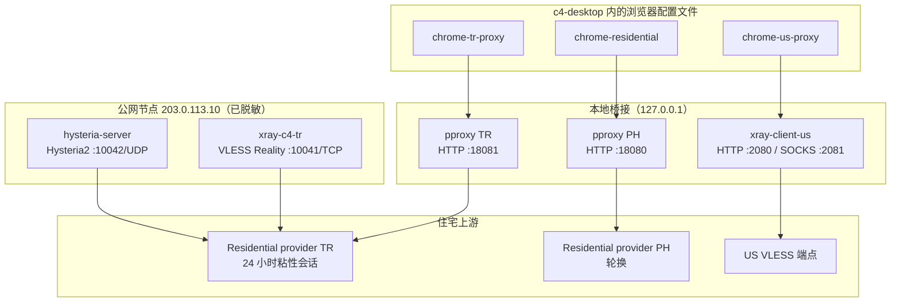

# 05 — 代理与网络

这是环境中运维上最敏感的部分。它描述代理链、两个公网住宅节点、DNS、泄漏控制、延迟，以及

指纹浏览器必须关闭的缺口。

所有凭据、UUID、密钥、会话 ID 和公网地址均已脱敏。

---

## 1. 拓扑



住宅上游有两种不同用法：

1. **浏览器本地桥接**（`18080`、`18081`）—— Chrome 通过 `--proxy-server` 使用。
2. **公网节点**（`10041/TCP`、`10042/UDP`）—— 远程客户端（v2rayN、Clash、Shadowrocket）
   和 VLESS/Hysteria2 测试矩阵使用。

两条路径目前共享同一个 TR 粘性会话。这对一致性很方便，但意味着所有 TR 流量竞争同一个
住宅带宽和会话配额。

---

## 2. 本地桥接

### 2.1 US VLESS —— `xray-client-us`

| 属性 | 值 |
|---|---|
| 服务 | `xray-client-us.service` |
| 监听 | `127.0.0.1:2080` HTTP，`127.0.0.1:2081` SOCKS5 |
| 协议 | VLESS + REALITY + `xtls-rprx-vision` |
| 传输 | TCP |
| TLS 指纹 | `chrome` |
| UDP | SOCKS 入站有 `udp: true`；出站仅 TCP |
| 端点 | 已脱敏（公开副本为 `198.51.100.20:24447`） |
| 使用者 | `chrome-us-proxy`、Claude/Codex 终端工作 |

HTTP 入站超时 300 秒。SOCKS 入站支持本地 UDP，但 VLESS 出站是 TCP，因此 UDP 实际上受限。

### 2.2 PH 轮换 —— `proxy-bridge`

| 属性 | 值 |
|---|---|
| 服务 | 临时 `proxy-bridge.service`（systemd-run） |
| 进程 | `pproxy 2.7.9`（Python） |
| 监听 | `127.0.0.1:18080` HTTP |
| 上游 | Residential provider PH 轮换住宅 |
| 使用者 | `chrome-residential` |

这是一个**临时**单元，不是 `/etc/systemd/system` 中的文件。除非有东西重新创建它，否则
重启后不会恢复。这是可靠性风险。

### 2.3 TR 粘性 —— `proxy-bridge-tr`

| 属性 | 值 |
|---|---|
| 服务 | `proxy-bridge-tr.service`（永久） |
| 进程 | `pproxy 2.7.9` |
| 监听 | `127.0.0.1:18081` HTTP |
| 上游 | Residential provider TR 24 小时粘性会话 |
| 出口 | 土耳其住宅（已脱敏） |
| 使用者 | `chrome-tr-proxy` |

该单元把上游 URL（包括会话用户名和密码）嵌在 `ExecStart` 中。文件实际上只有 root 能读，
但凭据在 `systemctl cat` 和进程列表中可见。生产设计应使用权限 `0600` 的
`EnvironmentFile` 或本地凭据代理。

---

## 3. 公网住宅节点

### 3.1 VLESS Reality —— `10041/TCP`

| 属性 | 值 |
|---|---|
| 服务 | `xray-c4-tr.service` |
| 二进制 | `/usr/local/bin/xray-26.6.27`（固定版本） |
| 监听 | `0.0.0.0:10041` |
| 协议 | VLESS + REALITY + Vision |
| SNI 目标 | `addons.mozilla.org:443` |
| Flow | `xtls-rprx-vision` |
| UDP | 不支持（HTTP 上游仅 TCP） |
| 上游 | Residential provider TR HTTP 代理 |
| 路由 | `tr-residential-in` → `tr-http-out`；另有 blackhole |

Xray 版本固定为 `26.6.27`，因为较新的 REALITY 实现与 Mihomo 客户端认证失败。这是兼容性
约束，不是偏好。任何升级都必须先通过客户端矩阵测试。

### 3.2 Hysteria2 —— `10042/UDP`

| 属性 | 值 |
|---|---|
| 服务 | `hysteria-server.service` |
| 二进制 | `/usr/local/bin/hysteria` 2.13.0 |
| 监听 | `:10042` UDP |
| 认证 | 密码（已脱敏） |
| 混淆 | Salamander（密码已脱敏） |
| TLS | 自签名，CN `www.bing.com`，10 年 |
| SNI 守卫 | 禁用 |
| UDP 转发 | `disableUDP: true` |
| 上游 | 同一个 Residential provider TR HTTP 代理 |
| Masquerade | 反向代理到 `https://www.bing.com` |

Hysteria2 基于 QUIC，因此客户端到 VPS 这一段是 UDP 且加密。VPS 到 Residential provider 这一段仍然是
HTTP 代理，不能承载 UDP。因此 `disableUDP: true` 是正确的：节点在 QUIC 内隧道 TCP，不
提供端到端 UDP。

自签名证书要求客户端 `insecure=1` / `skip-cert-verify`。这削弱了认证，生产部署应换成
真实证书或固定公钥。

### 3.3 端口状态

| 端口 | 协议 | 状态 |
|---|---|---|
| `10041` | TCP | VLESS Reality + Vision，活动 |
| `10042` | UDP | Hysteria2，活动 |
| `10042` | TCP | 无监听；旧直连节点已移除 |
| `2204` | TCP | 容器 SSH |
| `3389` | TCP + UDP | XRDP |
| `8088` | TCP | goods24 web（Caddy） |

`10042/TCP` 仍有 LXD proxy 设备。未使用时无害，但应移除以减少攻击面。

---

## 4. DNS

当前路径：

```text
Chrome
  → systemd-resolved stub 127.0.0.53
  → 上游 10.0.43.1（LXD dnsmasq）
  → 主机解析器
  → 互联网
```

Chrome 以 `--disable-features=DnsOverHttps` 启动，因此不使用 DoH。使用 HTTP 代理时，
Chrome 对 HTTP 和 HTTPS CONNECT 都把目标主机名发给代理；由代理解析。这对代理路径是好的。
但是：

- 系统服务、Chrome 后台服务和任何非代理请求仍使用本地解析器；
- 没有按配置文件的 DNS 解析器；
- 启动脚本没有 DNS 泄漏测试；
- 解析器能看到每个非代理主机名。

指纹浏览器应让 DNS 走与配置文件相同的出口，或运行绑定到代理路径的按配置文件解析器。
“禁用 DoH”不是 DNS 泄漏策略；它是没有策略。

---

## 5. IPv6 —— 真实泄漏

容器有：

```text
eth0: 10.0.43.40/24
      fd42:43::216:3eff:fe41:db37/64
default via fe80::216:3eff:fed8:d793 dev eth0
```

尽管只有 ULA 地址，IPv6 出口仍然可用：

```text
$ curl -6 https://api64.ipify.org
2001:db8::10
```

这是**主机在东京的全球 IPv6 地址**，不是土耳其住宅出口。任何支持 IPv6 的直接连接都会
绕过 IPv4 住宅代理。Chrome 的 `--proxy-server` 覆盖 HTTP(S) URL，WebRTC 也受限，因此
常见路径受保护。但泄漏是潜在的：

- 代理绕过规则匹配了 IPv6 目标；
- Chrome 后台请求不走代理；
- 扩展或自动化脚本使用原始 socket；
- 未来功能启用直接 UDP 或 IPv6。

产品建议：在配置文件网络命名空间中禁用 IPv6，或用防火墙 fail-closed，并把 IPv6 泄漏
检查加入启动前测试。

---

## 6. 泄漏控制矩阵

| 向量 | 当前控制 | 状态 |
|---|---|---|
| HTTP(S) 目标 | 每配置文件 `--proxy-server` | 已覆盖 |
| QUIC / HTTP3 | `--disable-quic` | 已覆盖 |
| WebRTC UDP | 策略 + 参数，`disable_non_proxied_udp` | 已覆盖 |
| WebRTC 本地 IP | `--enforce-webrtc-ip-permission-check` | 已覆盖 |
| DoH | `--disable-features=DnsOverHttps` | 已禁用，但未替代 |
| 系统 DNS | 无 | **泄漏** |
| IPv6 | 无 | **泄漏**（已实测直接出口） |
| 非 HTTP 协议 | 无 | 原始 socket **泄漏** |
| 代理故障 | Chrome 显示错误，无 kill switch | 操作系统层 **fail-open** |
| 时区 | 无 | **不一致**，不是网络泄漏 |
| 语言 | 无 | **不一致**，不是网络泄漏 |

生产启动器需要 **fail-closed** 网络策略：代理宕机时，配置文件必须没有直接出口。今天，
杀掉 `proxy-bridge-tr` 后容器仍有直接互联网访问；Chrome 会显示代理错误，但其他进程仍能
上网。

---

## 7. 延迟

住宅路径以**实际 HTTP 请求时间**衡量，不是 ICMP。三个层次经常被混淆：

1. **到 VPS 的 TCP RTT** —— `tcping 203.0.113.10 10041` 测量的值。更换住宅出口不会改变它。
2. **VPS → 住宅网关 RTT** —— HTTP 代理连接时间，基准中约 170–190 ms。
3. **端到端页面/请求时间** —— 包括住宅最后一公里和目标站点；粘性会话下容器访问
   `generate_204` 约 1.3 秒。

容器内十个 24 小时粘性会话的基准：

| 会话排名 | `time_total`（3 次） | 出口 |
|---|---|---|
| 1（选中） | 1.27–1.40 s | TR |
| 2 | 1.38–1.42 s | TR |
| 3 | 1.46–1.50 s | TR |
| 4 | 1.58–1.65 s | TR |
| 5 | 1.58–1.72 s | TR |
| 6 | 1.73–2.01 s | TR |
| 7 | 1.75–2.13 s | TR |
| 8 | 2.05–2.42 s | TR |
| 9 | 3.21–4.21 s | TR |
| 10 | 超时 | 不可达 |

选中的是速度最快且最稳定的会话。客户端机器的端到端测试：

| 节点 | HTTP 总时间（3 次） |
|---|---|
| VLESS `10041/TCP` | 1.89 / 1.89 / 1.91 s |
| Hysteria2 `10042/UDP` | 1.62 / 1.64 / 1.89 s |

Hysteria2 略快，因为客户端到 VPS 段是 QUIC over UDP，避免了 TCP 队头阻塞。两个出口是
同一个土耳其住宅 IP。

### 如何理解“700 ms”

700 ms 通常是到 VPS 的 TCP 握手，不是页面加载。更换住宅会话不会改善它。如果抱怨的是
页面延迟，应分别测量三层并做同类比较。如果是住宅最后一公里，选择更快的会话（本文就是
这样做的）或换供应商。

---

## 8. 会话生命周期

TR 会话 TTL 为 24 小时。过期后必须在三处替换上游用户名：

1. `/etc/xray-c4-tr/config.json` —— `tr-http-out` 用户；
2. `/etc/hysteria/config.yaml` —— `outbounds[0].http.url`；
3. `/etc/systemd/system/proxy-bridge-tr.service` —— `-r` 参数。

然后重启：

```bash
systemctl restart xray-c4-tr hysteria-server proxy-bridge-tr
```

生产系统应自动化：

- 生成 N 个候选会话；
- 从 VPS 逐个基准测试；
- 选择最快且稳定的；
- 原子更新三处配置；
- 重启并验证出口 IP/国家；
- 失败回滚；
- 永不要把按流量计费的住宅节点放进基于延迟的自动测试组。

最后一点很重要：Clash `url-test` 组会持续探测节点，消耗住宅带宽。提供的 Clash 配置
刻意没有自动测试组。

---

## 9. 安全观察

| 观察 | 风险 |
|---|---|
| Residential provider 上游是明文 HTTP | VPS→网关段的凭据和代理请求没有 TLS 保护 |
| 代理凭据在 `ExecStart` 中 | 进程列表和单元文件可见 |
| Hysteria2 自签名证书 + `insecure=1` | 客户端不验证服务器 |
| Xray 固定旧版本 | 已知兼容性权衡；必须跟踪 CVE |
| `10042/TCP` 映射未使用 | 不必要的攻击面 |
| 无 fail-closed 策略 | 代理故障回退到直接出口 |
| 住宅供应商能看到流量 | 供应商按定义是受信任第三方 |

明文 HTTP 上游最重要：VLESS/Hysteria2 加密止于 VPS。从 VPS 到
`proxy.example-provider.net:32345`，HTTP 代理携带凭据和请求元数据，没有 TLS。未来设计应使用 HTTPS
代理端点、支持 TLS 的供应商，或把 HTTP 代理隧道放进 TLS 连接。

---

## 10. 证据

- [`../../inventory/container/08-proxy-services.txt`](../../inventory/container/08-proxy-services.txt)
- [`../../inventory/container/09-network.txt`](../../inventory/container/09-network.txt)
- [`../../inventory/container/proxy-latency.md`](../../inventory/container/proxy-latency.md)
- [`../../inventory/host/04-ports.txt`](../../inventory/host/04-ports.txt)
- [`../../configs/proxy/`](../../configs/proxy/)
