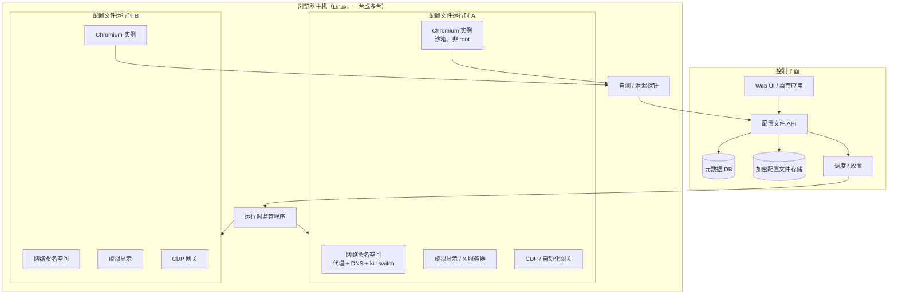

# 08 — 目标架构

本文档把清单转化为 Linux 指纹浏览器的设计。它是提案，不是实现。指导原则是：
**一致性优先，隔离第二，伪造第三**。

---

## 1. 设计原则

1. **配置文件是环境，不是目录。** Cookie 是容易的部分。时区、区域、字体、显示、GPU、
   媒体设备和网络都必须属于配置文件。
2. **一致性胜过随机性。** 一个与操作系统、GPU 和驱动矛盾的随机 WebGL 字符串，比一个
   朴素但一致的值更糟。
3. **按配置文件确定。** 同一配置文件在多次启动间必须产生相同指纹。创建时随机一次，然后
   持久化 seed。
4. **Fail closed。** 如果代理、DNS 或自测失败，配置文件不得回退到直接出口。
5. **最小权限。** 浏览器以非 root 用户运行，启用沙箱，在独立命名空间/容器中。
6. **测量一切。** 每次启动产生可 diff 的自测报告。
7. **晚打补丁，小打补丁。** 先用参数、策略和操作系统隔离，再碰 Blink。只为浏览器外部
   无法解决的问题分支。

---

## 2. 系统总览



### 组件

| 组件 | 职责 |
|---|---|
| **控制平面** | 配置文件 CRUD、所有权、配额、调度、审计日志 |
| **配置文件存储** | 加密 user-data 目录、清单、快照、产物 |
| **指纹编译器** | 人格 + seed → 一致性清单 |
| **运行时监管程序** | 创建命名空间/显示、启动浏览器、执行限制、崩溃重启 |
| **网络平面** | 按配置文件代理、DNS、IPv6 策略、kill switch、泄漏测试 |
| **浏览器运行时** | 先用原版 Chrome；之后 Chromium 分支 |
| **自动化网关** | 带认证的 CDP/Playwright/MCP 访问 |
| **可观测性** | 自测、截图、日志、指纹 diff、告警 |

---

## 3. 配置文件模型

配置文件是版本化记录加加密数据目录。

```yaml
schema_version: 1
id: tr-ist-01
name: "TR Istanbul / Linux desktop"
seed: "<64 hex chars, generated once>"
created_at: "2026-11-12T00:00:00Z"
chrome_version: "156.0.8078.79"
patchset_version: "0.1.0"

persona:
  platform: linux          # linux | windows | macos (target)
  fidelity: native         # native | masked | cross-platform
  timezone: Europe/Istanbul
  locale: tr-TR
  languages: [tr-TR, tr]
  currency: TRY
  screen: {width: 1920, height: 1080, dpr: 1}
  color_scheme: light
  media:
    audio_output: true
    audio_input: false
    video_input: false
  fonts: default-linux-tr
  gpu: {mode: software, vendor: "Google Inc. (Mesa)", renderer: "ANGLE (Mesa, llvmpipe ...)"}

network:
  mode: http_proxy
  endpoint: "http://127.0.0.1:18081"
  expected_exit: {country: TR, timezone: Europe/Istanbul, asn: "<redacted>"}
  dns: remote
  ipv6: disabled
  kill_switch: true

automation:
  cdp: true
  cdp_auth: token
  webdriver: false
  allowed_origins: ["http://127.0.0.1:..."]

lifecycle:
  storage_quota_gb: 5
  snapshot_on_exit: true
  ephemeral: false
```

**清单**是编译后的、不可变的描述，说明浏览器应暴露什么。**seed** 是唯一的随机输入；
其他一切由它和人格确定性地派生。这使配置文件可复现、可测试。

### 保真层级

| 层级 | 含义 | 现在可行？ |
|---|---|---|
| **原生** | Linux 人格在 Linux 上；UA、字体、GPU 全部一致 | 是 |
| **掩码** | Linux 主机，但使用不同的区域/时区/屏幕/网络 | 是 |
| **跨平台** | 在 Linux 上呈现 Windows/macOS 人格 | 不分支或不用 VM 不行 |

MVP 应发布**原生 Linux 人格**。Linux Chrome 上的 Windows 人格是矛盾，需要重度修补的
Chromium 或 Windows VM。在可测试之前不要承诺。

---

## 4. 运行时隔离

### 4.1 选项

| 选项 | 隔离 | 成本 | 说明 |
|---|---|---|---|
| 独立 `--user-data-dir` | 仅存储 | 低 | 当前状态；不够 |
| 独立 Linux 用户 + X 显示 | 中 | 低 | 更好；仍共享内核/网络 |
| 每配置文件容器 | 高 | 中 | LXD/Docker；独立 netns、显示、字体 |
| 每配置文件网络命名空间 | 高（网络） | 中 | 需要 root；nftables、veth、DNS |
| 每配置文件 VM | 最高 | 高 | KVM；Windows 人格需要 |
| 每配置文件组容器 | 中高 | 中 | 务实：每组 5–10 个配置文件 |

**建议：** 从**每组一个容器**开始，容器内**每个配置文件一个网络命名空间**（如果密度
可接受，也可以每个配置文件一个容器）。这样每个配置文件有自己的显示、字体、时区和网络，
而不需要每个配置文件一个 VM 的成本。

### 4.2 显示

选项：

- **每配置文件 Xvfb** —— 轻量，但没有 GPU 和窗口管理器；适合无头自动化，不适合真实的
  屏幕/窗口信号。
- **每配置文件 Xorg + XRDP** —— 真实，但重；每个配置文件一个 X 服务器。
- **Xephyr/嵌套 X** —— 中等；共享宿主 X 服务器。
- **Wayland 无头合成器** —— 现代，但 Chrome 的 Ozone/Wayland 路径会改变指纹。

MVP 用固定几何的 Xvfb 就足以让 `screen` 一致。桌面级产品用每配置文件 Xorg/XRDP 更好。
当前单一 `:10` 是要消除的东西。

### 4.3 权限

- 每个配置文件用专用非 root 用户运行 Chrome。
- 保持沙箱启用（`chrome-sandbox` setuid 或用户命名空间）。
- 丢弃 capabilities；尽可能用 `nosuid,nodev,noexec` 挂载 `/tmp` 和配置文件目录。
- 禁用配置文件间共享剪贴板。
- 不要把 Docker socket 或主机路径挂进浏览器容器。

---

## 5. 网络平面

### 5.1 需求

- 每个配置文件只有一条出口路径。
- DNS 走同一路径（HTTP/SOCKS5h 用远程 DNS）。
- IPv6 禁用或经代理路由。
- 代理宕机时没有直接出口。
- 除代理明确支持的 UDP 外没有 UDP。
- 按配置文件流量计费。
- 健康检查不消耗按流量计费的住宅带宽。

### 5.2 实现草图

```text
profile netns
  ├─ veth pair → bridge → nftables
  ├─ default route → proxy bridge (local)
  ├─ reject all direct output except to the proxy bridge
  ├─ redirect/deny UDP 53 to non-proxy resolvers
  ├─ disable IPv6 (sysctl net.ipv6.conf.all.disable_ipv6=1)
  └─ kill switch: if proxy health check fails, drop all output
```

对 HTTP 代理，Chrome 对 HTTP 和 CONNECT 在代理解析主机名。对 SOCKS5h，使用远程 DNS。
任何直接 DNS，都应运行绑定到配置文件的解析器并通过代理转发（DoH over proxy），而不是
主机解析器。

### 5.3 泄漏测试

每次启动前和定期运行：

| 测试 | 预期 |
|---|---|
| IPv4 出口 | 匹配配置文件的国家/ASN |
| IPv6 出口 | 无，或匹配配置文件 |
| DNS 解析器 | 配置文件解析器，不是主机解析器 |
| WebRTC 候选 | 经代理或为空 |
| QUIC | 禁用 |
| 直连 TCP 到 canary | 被阻止 |
| 代理宕机 | 所有出口被阻止，错误清晰 |

当前环境未通过 IPv6 和 DNS 测试（见 `05-proxy-and-network.md`）。

---

## 6. 指纹平面

### 6.1 编译器产出什么

| 域 | 值 |
|---|---|
| UA / UA-CH | 浏览器版本、平台、架构、位数、型号、平台版本 |
| Navigator | `platform`、`vendor`、`languages`、`hardwareConcurrency`、`deviceMemory`、`maxTouchPoints` |
| Screen | 宽、高、可用区域、DPR、色深、方向 |
| 时区 / 区域 | `Intl` 时区、区域、日历、数字系统、货币 |
| WebGL / WebGPU | 厂商、渲染器、参数、扩展 |
| Canvas / 音频 | 按配置文件确定的噪声，跨 API 一致 |
| 字体 | 家族列表和度量 |
| 媒体 | 设备类型、标签、能力 |
| 语音 | 语音和语言 |
| 网络 | 有效类型、下行、RTT（或省略） |
| 存储 | 配额（避免容器痕迹） |

### 6.2 确定性

- 从 `HMAC(seed, domain)` 派生值，使每个域稳定且独立。
- 持久化编译后的清单；不要每次启动重新随机。
- 编译器版本化；升级创建新清单版本和 diff。
- 记录每次清单变更及原因。

### 6.3 伪造还是虚拟化

| 方法 | 优点 | 缺点 |
|---|---|---|
| **虚拟化**（真实 GPU、字体、设备） | 最一致；补丁少 | 昂贵；难以按配置文件变化 |
| **在 Blink 中伪造** | 灵活；可按配置文件 | 维护高；交叉检查可检测 |
| **在边界伪造**（Mojo、CDP、代理） | 补丁面小 | 对 canvas/字体不够 |

务实组合：

- 尽可能虚拟化网络、显示、时区、区域和字体；
- 在浏览器中伪造 UA-CH、WebGL 字符串、canvas/音频噪声和媒体设备标签；
- 所有值保留单一事实来源（清单）。

### 6.4 必须通过交叉检查

严肃的反检测目标会交叉检查：

- UA vs UA-CH vs `navigator.platform` vs `userAgentData`；
- 时区 vs `Intl` vs `Date` vs IP 地理位置；
- WebGL 厂商/渲染器 vs GPU 信息 vs canvas 性能；
- 字体 vs canvas 度量 vs `document.fonts.check`；
- 屏幕 vs 窗口 vs `devicePixelRatio` vs 截图；
- 媒体设备 vs `enumerateDevices` vs 实际权限提示；
- TCP/TLS/HTTP2 指纹 vs 声称的浏览器；
- 行为 vs 自动化标志。

清单必须对所有这些内部一致，而不只是容易的部分。

---

## 7. 浏览器层

### 7.1 原版 Chrome + 监管程序（MVP）

使用 Chrome 的参数、策略和操作系统隔离：

- `--proxy-server`、`--disable-quic`、WebRTC 策略；
- 每配置文件 `--user-data-dir`；
- 每配置文件容器/命名空间，带 `TZ`、`LANG`、字体、显示；
- `--enable-unsafe-swiftshader --ignore-gpu-blocklist` 恢复 WebGL；
- `--accept-lang` 和 `--lang`；
- 不用 `--enable-automation`；受控 CDP 端口带认证。

这覆盖网络、配置文件、时区、区域和 WebGL 可用性。它**不**覆盖 GPU 字符串、canvas/字体
度量，或非原生平台上的 UA-CH。

### 7.2 Chromium 分支（以后）

按顺序加入：

1. UA-CH 和平台一致性；
2. 每渲染器时区/区域（或每配置文件进程）；
3. WebGL/WebGPU 厂商/渲染器和参数虚拟化；
4. canvas/音频确定性噪声；
5. 字体度量虚拟化；
6. 媒体设备虚拟化；
7. 自动化/CDP 策略；
8. 品牌和打包。

每个补丁都需要自测工具中的测试和 rebase 说明。把补丁栈放在独立仓库或带清单的
`patches/` 目录。

### 7.3 构建还是购买

| 方法 | 到 MVP 时间 | 控制力 | 维护 |
|---|---|---|---|
| 原版 Chrome + 监管程序 | 数周 | 中 | 低 |
| Chromium 分支 + 补丁 | 数月 | 高 | 高 |
| Electron/CEF 包装 | 数周 | 低中 | 中（但不是真正的浏览器） |
| 每配置文件 VM + 原版 Chrome | 数周 | 中 | 中高 |
| 购买现成反检测产品 | 数天 | 低 | 依赖供应商 |

简报提到 BitBrowser 和 Ziniao。它们验证了市场，但是封闭系统。可信的开放产品需要自己的
配置文件契约和测量工具，即使第一个运行时是原版 Chrome。

---

## 8. 自动化与 AI/MCP

### 8.1 CDP 网关

- 把 CDP 绑定到 `127.0.0.1` 的临时端口。
- 前面放本地认证网关；永远不要把 CDP 暴露到网络。
- 尽可能使用 `--remote-debugging-pipe`，或带 token 保护的 WebSocket。
- 除非配置文件明确是自动化配置文件，否则避免 `--enable-automation`。
- 记录 `navigator.webdriver` 和其他自动化痕迹必须匹配配置文件策略。

### 8.2 Playwright / Puppeteer

- 用 `connectOverCDP` 连接网关，不要让 Playwright 用自己的参数启动 Chrome。
- 浏览器启动参数由监管程序控制；自动化不得覆盖代理、WebGL 或语言参数。
- 每次自动化会话开始时捕获自测报告。

### 8.3 MCP / LLM

MCP 服务器可以暴露工具：

- `profile.create`、`profile.start`、`profile.stop`、`profile.status`；
- `browser.navigate`、`browser.screenshot`、`browser.evaluate`；
- `fingerprint.self_test`、`network.leak_test`；
- `profile.export`、`profile.import`。

护栏：按配置文件授权、速率限制、审计日志、不泄漏密钥，以及对破坏性操作明确的人类在环
策略。

---

## 9. 存储与密钥

| 数据 | 存储 | 保护 |
|---|---|---|
| 配置文件元数据 | PostgreSQL/SQLite | 访问控制、备份 |
| User-data 目录 | 加密卷或按配置文件加密 | 密钥在 OS keyring/HSM |
| 代理凭据 | 密钥管理器，启动时注入 | 永不进 Git 或日志 |
| 清单 | 元数据 DB + 对象存储 | 版本化、签名 |
| 自测报告 | 对象存储 | 保留策略 |
| 截图 | 对象存储 | PII 审查 |

当前 VPS 把凭据放在单元文件和配置文件里。产品永远不要这样做。至少用 `0600` 的
`EnvironmentFile`，规模化时用密钥管理器。

---

## 10. 可观测性

每次配置文件启动应发出：

- 结构化日志（配置文件 id、Chrome 版本、补丁集、代理、出口 IP/国家）；
- 自测 JSON（`06-fingerprint-surface.md` 中的契约）；
- 已知测试页截图；
- 与上次运行的 diff；
- 泄漏测试结果；
- 崩溃报告 id（如有）。

仪表盘：

- 启动成功率；
- 按检查项的自测通过率；
- 泄漏事件（必须为零）；
- 代理延迟和失败率；
- 每主机磁盘/内存；
- 按版本的 Chrome 崩溃率。

---

## 11. 部署拓扑

### 单主机（MVP）

```text
控制平面（API + DB）  ──  浏览器主机（LXD/Docker）
                              ├─ 配置文件组 A
                              ├─ 配置文件组 B
                              └─ 共享代理桥接
```

### 横向扩展

- 把控制平面与浏览器主机分离。
- 按容量和网络延迟放置配置文件。
- 配置文件存储保持在本地主机（或快速共享卷）。
- 使用粘性放置的调度器，使配置文件回到同一主机。
- 健康检查主机；维护前 drain。

### 之后的 Windows

- 每组一个 Windows 主机或 VM；
- 同一控制平面、同一清单 schema、平台特定编译器；
- 独立构建流水线和签名。

---

## 12. 本架构刻意不做什么

- 不承诺不可检测。它承诺一致性和可测量性。
- 不在第一天把每个配置文件放进 VM；那是成本决定。
- 在配置文件契约稳定前不修补 Chromium。
- 不在仓库或命令行存储密钥。
- 不依赖单台 VPS 同时做构建和运行时。

---

## 13. 相关文档

- 清单：[`00-overview.md`](00-overview.md)、[`06-fingerprint-surface.md`](06-fingerprint-surface.md)
- 网络：[`05-proxy-and-network.md`](05-proxy-and-network.md)
- 构建：[`07-build-toolchain.md`](07-build-toolchain.md)
- 计划：[`09-roadmap.md`](09-roadmap.md)
